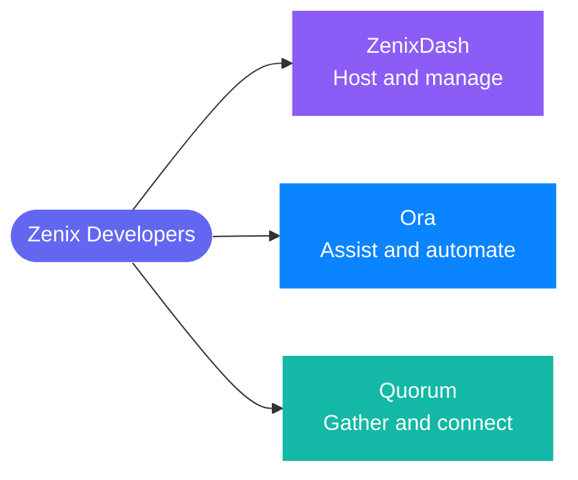

## Hello, we're Zenix

We build calm, capable software that makes complicated things feel effortless: hosting you can run from one graceful dashboard, communities you can own, and an AI companion that lends your PC a helping hand while you stay in charge.

## Our projects

| Project | What it is |
|---|---|
| 🚀 [**ZenixDash**](https://github.com/Zenix-Developers/ZenixDash-Showcase) | A hosting control plane for game servers, virtual servers and websites, with billing, community and an AI Copilot in one dashboard. |
| 🤖 [**Ora**](https://github.com/Zenix-Developers/Ora-Showcase) | A desktop AI assistant for Windows with missions, sub-agent teams and approvals that keep you in control. [Visit the site](https://ora.zenix.sg) |
| 💬 [**Quorum**](https://github.com/Zenix-Developers/Quorum-Showcase) | A self-hosted community platform with servers, channels, voice, video and a full admin panel. |

## Find us

🌐 [zenix.sg](https://zenix.sg) · 🤖 [ora.zenix.sg](https://ora.zenix.sg) · ✉️ [escher@zenix.sg](mailto:escher@zenix.sg)

Showcase repositories contain no source code, only a tour of each project. Interested in a closer look? Get in touch.
